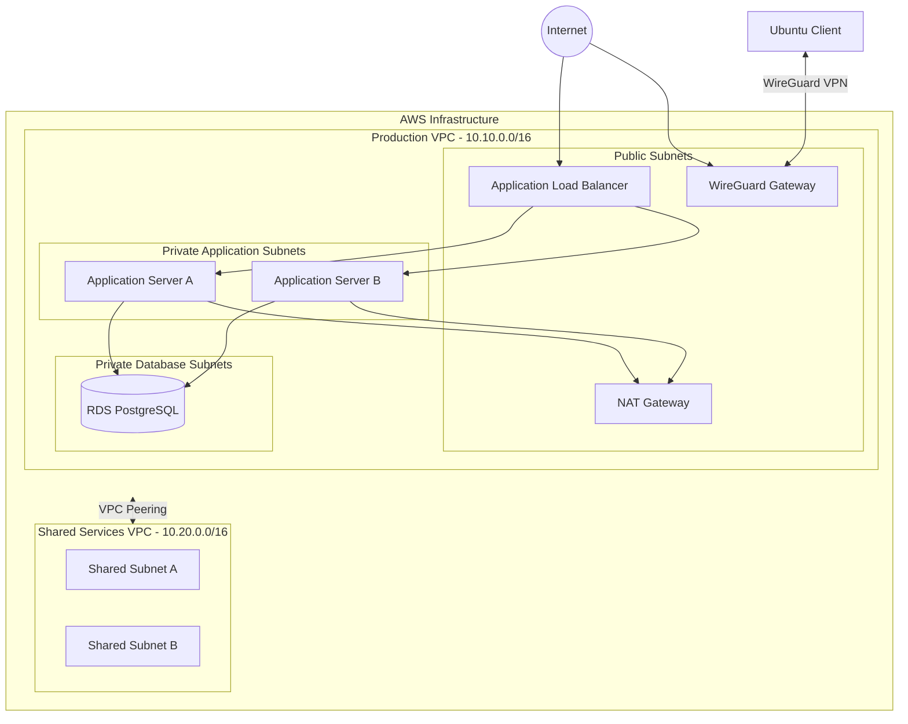
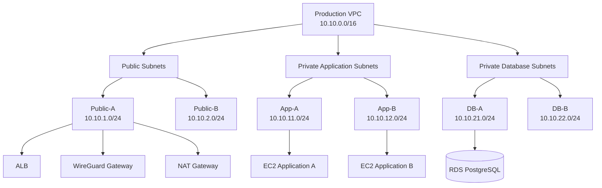
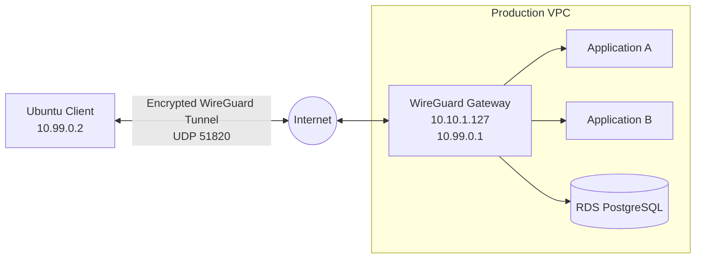

# Secure Multi-Tier Enterprise Network on AWS

## Project Overview

This project demonstrates how to build a secure, multi-tier network infrastructure on AWS using Terraform.

It simulates an enterprise network with separate network tiers for public access, application workloads, and database resources. It also demonstrates how to connect separate VPCs and establish secure remote access to private AWS resources using WireGuard VPN.

### What This Project Builds

- Production VPC with public and private subnets.
- Separate application and database network tiers.
- Internet Gateway and NAT Gateway for network connectivity.
- Application Load Balancer to distribute application traffic.
- Private EC2 application servers.
- Amazon RDS PostgreSQL database.
- Security Groups and Network ACLs for traffic control.
- VPC Peering between Production and Shared Services VPCs.
- WireGuard VPN for secure remote access.
- VPC Flow Logs and CloudWatch monitoring.
- Terraform configuration for infrastructure management.

---

## Architecture

### 1. Overall Network Architecture



### 2. Production VPC Network Layout



### 3. Hybrid VPN Connectivity



---

## Repository Structure

```text
secure-network-aws/
│
├── README.md
├── .gitignore
├── ec2-trust-policy.json
├── flowlogs-permissions.json
├── flowlogs-trust-policy.json
│
└── terraform/
    ├── .terraform.lock.hcl
    ├── providers.tf
    ├── variables.tf
    ├── vpc.tf
    ├── subnets.tf
    ├── internet-gateway.tf
    ├── route-tables.tf
    ├── routes.tf
    ├── associations.tf
    ├── eip.tf
    ├── nat.tf
    ├── security-groups.tf
    ├── security-group-rules.tf
    ├── network-acls.tf
    ├── network-acl-rules.tf
    ├── network-acl-associations.tf
    ├── instances.tf
    ├── alb.tf
    ├── target-group.tf
    └── listeners.tf
```

## Terraform File Description

| File | Purpose |
|---|---|
| `providers.tf` | Configures the AWS provider. |
| `variables.tf` | Defines Terraform input variables. |
| `vpc.tf` | Defines the Production VPC. |
| `subnets.tf` | Defines public, application, and database subnets. |
| `internet-gateway.tf` | Configures the Internet Gateway. |
| `route-tables.tf` | Defines route tables. |
| `routes.tf` | Configures network routes. |
| `associations.tf` | Associates subnets with route tables. |
| `eip.tf` | Defines the Elastic IP for NAT. |
| `nat.tf` | Defines the NAT Gateway. |
| `security-groups.tf` | Defines Security Groups. |
| `security-group-rules.tf` | Defines individual Security Group rules. |
| `network-acls.tf` | Defines the application Network ACL. |
| `network-acl-rules.tf` | Defines Network ACL rules. |
| `network-acl-associations.tf` | Associates the Network ACL with subnets. |
| `instances.tf` | Defines the EC2 instances. |
| `alb.tf` | Defines the Application Load Balancer. |
| `target-group.tf` | Defines the ALB target group and attachments. |
| `listeners.tf` | Defines the ALB listener. |
| `.terraform.lock.hcl` | Locks Terraform provider versions. |

The JSON files in the root directory contain IAM trust and permission policies used by the infrastructure.

---

# How to Use This Project

## Step 1: Prerequisites

Install the following tools:

- AWS CLI
- Terraform
- Git
- Ubuntu or another Linux environment
- An AWS account with the required permissions

Verify the installations:

```bash
aws --version
terraform --version
git --version
```

Configure AWS CLI credentials:

```bash
aws configure
```

Verify AWS access:

```bash
aws sts get-caller-identity
```

Do not commit AWS credentials, private keys, or other secrets to this repository.

## Step 2: Clone the Repository

```bash
git clone https://github.com/ragunthan-source/secure-network-aws.git

cd secure-network-aws
```

Move into the Terraform directory:

```bash
cd terraform
```

## Step 3: Initialize Terraform

```bash
terraform init
```

This downloads the required Terraform provider plugins and initializes the working directory.

## Step 4: Format the Configuration

```bash
terraform fmt -recursive
```

This formats the Terraform files consistently.

## Step 5: Validate the Configuration

```bash
terraform validate
```

This checks the Terraform configuration for syntax and configuration errors.

## Step 6: Review the Execution Plan

```bash
terraform plan
```

Review the proposed changes before applying anything.

**Important:** This repository contains configuration for infrastructure that was imported into Terraform state during development. A fresh clone does not contain that state.

If you are deploying this project in your own AWS account, you must configure the required variables and networking dependencies, and create or import the required resources into Terraform state before expecting the configuration to manage existing infrastructure.

Do not run `terraform apply` without understanding the plan.

## Step 7: Apply Infrastructure Changes

Only after configuring the environment and reviewing the execution plan:

```bash
terraform apply
```

Terraform will ask for confirmation before making the proposed changes.

## Step 8: Verify the Infrastructure

After deployment, verify the relevant AWS resources:

```bash
aws ec2 describe-vpcs
aws ec2 describe-subnets
aws ec2 describe-instances
aws ec2 describe-route-tables
aws elbv2 describe-load-balancers
```

Verify the application through the ALB DNS name:

```bash
curl http://<ALB-DNS-NAME>
```

Replace `<ALB-DNS-NAME>` with the DNS name of your Application Load Balancer.

---

# Important Notes

- Terraform state files are not included in this repository.
- The current Terraform configuration manages imported resources; it is not a complete standalone deployment package.
- RDS, Shared Services VPC, IAM, and monitoring resources are not yet fully managed by Terraform.
- The ALB currently uses HTTP; HTTPS has not been configured.
- The RDS deployment is Single-AZ.
- The NAT Gateway is deployed in one Availability Zone.
- Shared Services VPC workloads have not yet been deployed.
- WireGuard VPN access is configured for the Production VPC.

## Cleanup

Before removing infrastructure, inspect the Terraform execution plan:

```bash
terraform plan -destroy
```

Only proceed with destruction after confirming that the plan contains resources you actually intend to remove.

Resources created outside Terraform may need to be cleaned up separately.

---

## Project Goal

The goal of this project is to gain practical experience designing, configuring, securing, validating, and managing AWS network infrastructure using Terraform.

It brings together AWS networking, cloud security, hybrid connectivity, compute, databases, monitoring, and Infrastructure as Code in one practical project.
